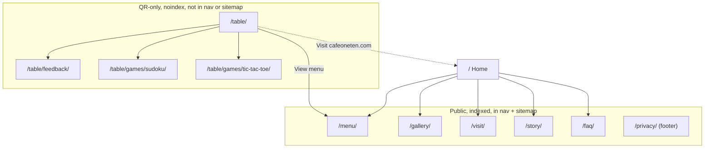
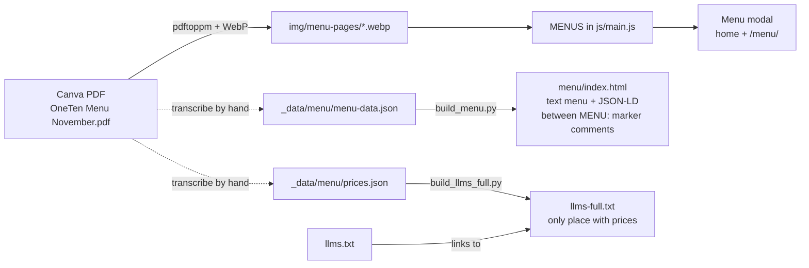
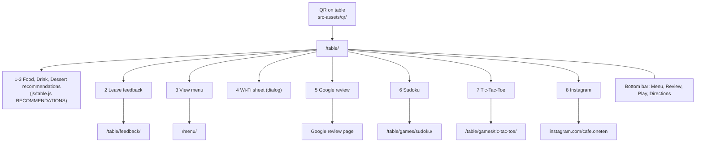
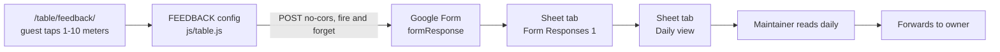

# Cafe OneTen — CODEBASE

Maintainer guide for the Cafe OneTen website (`https://cafeoneten.com`). Read this first; then use [`SITEMAP.md`](SITEMAP.md) for per-route detail. Written 24 Nov 2026.

## Contents

1. [Overview](#1-overview)
2. [Folder map](#2-folder-map)
3. [Pages](#3-pages)
4. [Diagrams](#4-diagrams)
5. [Design system](#5-design-system)
6. [How-to recipes](#6-how-to-recipes)
7. [SEO and AI visibility](#7-seo-and-ai-visibility)
8. [Links and accounts](#8-links-and-accounts)
9. [Caching and deploy](#9-caching-and-deploy)
10. [Open items and owner to-dos](#10-open-items--owner-to-dos)
11. [Change log](#11-change-log)

---

## 1. Overview

Cafe OneTen is an all-day cafe and rooftop restaurant in Nallagandla, Hyderabad. The site is a marketing site (home, menu, gallery, visit, story, FAQ, privacy) plus a guest-only **"At your table"** section at `/table/`, reached by scanning a QR code on the table.

**Stack:** hand-written static HTML, CSS and vanilla JavaScript. No framework, no bundler, no `package.json` at the root, no build step for the pages themselves. Served by Apache on Hostinger; behaviour is configured in `.htaccess`. Two small Python scripts in `_data/menu/` generate parts of `menu/index.html` and `llms-full.txt` (run by hand, committed output).

**Run locally**

```bash
cd Cafe110/Version-2
python3 -m http.server 8110
# open http://localhost:8110
```

`python3 -m http.server` ignores `.htaccess`, so redirects, headers and the `_data/` block do not apply locally. Use trailing-slash URLs (`/menu/`, not `/menu`).

### Hard rules

1. **No prices on any page.** This is a standing owner decision (May 2026). No ₹ amounts in any HTML, JSON-LD or `/table/` page. The menu *images* in the modal still show prices because they are the printed menu pages; that is accepted. The **only** text exception is `/llms-full.txt`, a dated price list written for AI assistants. It is referenced only from `/llms.txt`, never linked from an HTML page, and not in `sitemap.xml`. Reason: prices change often and are wrong in stale search snippets, but AI assistants still get asked "how much is X" and should answer from a dated source. `build_menu.py` refuses to write if it detects a price, so prices cannot leak into `menu/index.html`. Before finishing any change, grep the HTML for `₹`. Note: `llms.txt` (not `-full`) does contain a couple of aggregate figures, such as the "average cost for two"; check before editing.
2. **Trailing-slash folder URLs everywhere.** Internal links, canonicals, sitemap entries and JSON-LD all use `/menu/`, `/visit/`, etc. (Fixed sitewide in commit `f4c5318`; a missing slash caused a Search Console redirect error.) Every page is `folder/index.html`.
3. **Bump the `?v=` cache-busters on every asset change.** CSS and JS are cached for a month and images for a year (see [section 9](#9-caching-and-deploy)). If you edit a file and do not change its `?v=` in every page that references it, returning visitors keep the old copy.

Also: **no personal email addresses** or secrets in the repo (`.mcp.json` and `.env` are gitignored).

---

## 2. Folder map

```
Version-2/
├── index.html                 Home
├── 404.html                   Branded error page (noindex)
├── menu/ gallery/ visit/ story/ faq/ privacy/     one index.html each (public pages)
├── table/                     QR-only guest section (noindex)
│   ├── index.html             Landing: recommendations, feedback, menu, Wi-Fi, review, games, Instagram
│   ├── feedback/index.html    Anonymous feedback form (renders from js/table.js FEEDBACK config)
│   └── games/{sudoku,tic-tac-toe}/index.html
├── css/
│   ├── style.css              Whole public site (tokens at L20-38, @font-face at L2-14)
│   ├── table.css              /table/* only; own copy of tokens, "Cream cafe" theme
│   └── games.css              /table/games/* only, loaded after table.css
├── js/
│   ├── main.js                Nav, hamburger, scroll effects, MENUS modal (menu viewer)
│   ├── gallery.js             Gallery filter + <dialog> lightbox
│   ├── table.js               RECOMMENDATIONS, Wi-Fi sheet, FEEDBACK config + submit
│   └── games/                 ES modules: sudoku-{logic,game,bank,ui}.js, tictactoe-{logic,ui}.js,
│       ├── tests/             sudoku.test.mjs, tictactoe.test.mjs (node:test)
│       └── package.json       {"type":"module"} so node --test treats files as ESM
├── fonts/                     Self-hosted woff2 (Cormorant Garamond, Jost, Dancing Script)
│                              fonts.css here is NOT referenced by any page (check before deleting)
├── img/
│   ├── heroes/                Hero WebPs: hero-day-*, menu-hero-nov-* (current), menu-hero-* (old, kept),
│   │                          story/visit/faq heroes (desktop + mobile)
│   ├── dishes/                Dish photos (WebP) used on home, gallery and /table/ recommendations
│   ├── interior/              4 interior/exterior shots for the gallery
│   ├── menu-pages/            Menu modal pages: food-1..11, bev-1..5, dessert-1..6 (WebP)
│   ├── logo/ favicon/ og/ story/    logo, icons (+manifest icons), OG image 1200x630, story images
├── src-assets/                NOT served. Source masters (see src-assets/README.md)
│   ├── oneten-white-logo-master.png (6250x6250), dish JPEGs, November hero poster PNGs
│   └── qr/                    oneten-table-qr.svg (print) + .png -> https://cafeoneten.com/table/
├── _data/                     Build sources; blocked from the web by .htaccess
│   ├── menu/                  menu-data.json, prices.json, build_menu.py, build_llms_full.py, README.md
│   └── feedback/README.md     How the Google Form feedback is wired
├── .htaccess                  Redirects, headers, cache, _data block, clean URLs
├── robots.txt  sitemap.xml  sitemap-images.xml  llms.txt  llms-full.txt  manifest.json
├── SITEMAP.md                 Route-by-route detail (kept; this file does not duplicate it)
├── plan.md                    Plan for the /table/ + gallery work (Nov 2026)
├── OneTen Menu.pdf, OneTen Menu November.pdf   Canva exports, gitignored (41-48 MB)
└── Google Search Console/, cafeoneten.com-Coverage-*/, .playwright-cli/   gitignored exports/logs
```

Task history lives one level up in `../tasks/todo.md` (outside this folder).

---

## 3. Pages

Detail for each route is in [SITEMAP.md](SITEMAP.md). "Nav" means the top nav and mobile menu.

| Route | File | Purpose | Index | Nav | In `sitemap.xml` |
|---|---|---|---|---|---|
| `/` | `index.html` | Home: hero, story, signature dishes, menu modal entry, reviews, visit | index | logo link | yes |
| `/menu/` | `menu/index.html` | Menu viewer (modal), price-free text menu, Menu JSON-LD | index | yes | yes |
| `/gallery/` | `gallery/index.html` | 10 photos, filters, lightbox | index | yes | yes |
| `/visit/` | `visit/index.html` | Hours, map, booking buttons | index | yes | yes |
| `/story/` | `story/index.html` | Brand story | index | yes ("Our Story") | yes |
| `/faq/` | `faq/index.html` | 15 FAQs + FAQPage schema | index | yes | yes |
| `/privacy/` | `privacy/index.html` | Privacy policy | index (no snippet directives) | footer | yes |
| `/404` | `404.html` | Error page (`ErrorDocument 404`) | noindex, follow | no | no |
| `/table/` | `table/index.html` | Guest landing from QR | **noindex, nofollow** | no | **no** |
| `/table/feedback/` | `table/feedback/index.html` | Anonymous feedback to Google Form | noindex, nofollow | no | no |
| `/table/games/sudoku/` | `table/games/sudoku/index.html` | Sudoku | noindex, nofollow | no | no |
| `/table/games/tic-tac-toe/` | `table/games/tic-tac-toe/index.html` | Tic-Tac-Toe | noindex, nofollow | no | no |
| `/llms.txt` | `llms.txt` | AI-readable site summary (no prices) | n/a | no | no |
| `/llms-full.txt` | `llms-full.txt` | Dated price list for AI (only price source) | n/a | no | no |

The `/table/` pages deliberately have no site nav or footer; only a slim logo header, a "Visit cafeoneten.com" link and a sticky bottom bar.

---

## 4. Diagrams

### (a) Site map



### (b) Menu data pipeline



ASCII: `PDF -> img/menu-pages -> MENUS -> modal`; `menu-data.json -> build_menu.py -> menu/index.html`; `prices.json -> build_llms_full.py -> llms-full.txt <- llms.txt`.

### (c) Table QR flow



Row order follows the page; the bottom bar links to `/menu/`, the review link, `/table/games/sudoku/` and the Maps link.

### (d) Feedback flow



There is **no sign-in, no database and no server-side script**: the page renders its questions from the `FEEDBACK` config and POSTs the answers straight to Google. The response is opaque (no CORS headers), so the page cannot tell whether the POST succeeded. Full wiring in [`_data/feedback/README.md`](_data/feedback/README.md).

> **CSP:** the `.htaccess` Content-Security-Policy allows `connect-src 'self' https://docs.google.com`, so the feedback `fetch()` is permitted on the live host. If the form ever moves to another service, add its domain to `connect-src`. After each deploy, submit once on the live `/table/feedback/` page and confirm a row lands in the Sheet.

---

## 5. Design system

### Colour tokens

Defined in `css/style.css` L20-38 (`:root`) and copied into `css/table.css` (which does not load `style.css`).

| Token | Hex | Use |
|---|---|---|
| `--gold` | `#C8952A` | Accent, buttons, `theme_color` in `manifest.json` |
| `--gold-light` | `#E8B84B` | Hover/highlight |
| `--gold-deep` | `#9A6E18` | Gold on light backgrounds |
| `--espresso` | `#1C120A` | Dark background, `theme-color` meta, manifest `background_color` |
| `--espresso-2` | `#2A1A0E` | Dark panels |
| `--espresso-3` (`--espresso-mid`) | `#3B2A18` | Dark cards |
| `--cream` | `#F7F2E6` | Page background |
| `--cream-warm` (`--cream-2`) | `#EDE4D0` | Warm panels |
| `--sand` | `#D4C09A` | Borders, muted |
| `--sage` | `#6B7C5A` | Botanical accent (style.css only) |
| `--marble` | `#F5F3EF` | Light surface (style.css only) |
| `--charcoal` | `#2C2825` | Body text |

`table.css` adds `--muted-on-dark #C2B19A`, `--muted-on-cream #5E4D39`, `--card #FFFFFF`, `--gold-line rgba(200,149,42,.35)`, `--warm-shadow`, `--radius 18px`, `--col 560px`, `--bar-h 64px`. `games.css` adds `--sdk-bad #B4472B` (wrong Sudoku cell) and the `--cell-line*` grid lines.

### Fonts

All three families are **self-hosted woff2** in `/fonts/`; the live pages load no Google Fonts CSS.

| Variable | Family | Files |
|---|---|---|
| `--font-serif` | Cormorant Garamond | `cormorant-garamond-300/400/500.woff2`, `cormorant-garamond-italic-300/400.woff2` |
| `--font-sans` | Jost | `jost-200/300/400/500/600.woff2` |
| `--font-script` | Dancing Script | `dancing-script-400/600/700.woff2` |

- **How they load:** the 13 `@font-face` rules are at the top of `css/style.css` (L2-14, `font-display: swap`). Each public page preloads three files in `<head>` (`story/index.html`: `dancing-script-700`, `cormorant-garamond-400`, `jost-300`, all `as="font" type="font/woff2" crossorigin`).
- **CSS is non-blocking:** `<link rel="preload" href="/css/style.css?v=2611c" as="style" onload="this.onload=null;this.rel='stylesheet'">` with a `<noscript>` fallback.
- **No Google Fonts.** All fonts are self-hosted woff2 in `/fonts/` (the CSP is `font-src 'self'`, so a Google Fonts link would be blocked). `404.html` used to link Google Fonts; that was removed on 24 Nov 2026 because it loads `style.css`, which already has the `@font-face` rules.
- **Table pages:** they don't load `style.css`, so `css/table.css` starts with its own copy of the same 13 `@font-face` rules (added 24 Nov 2026). If you add or change a font file, update both `style.css` and `table.css`.

### The table pages' "Cream cafe" theme

`/table/*` is a light theme, unlike the dark-espresso public site: cream page (`--cream`), white rounded cards (`--card`, 18px radius, thin gold border, soft warm shadow), gold icon tiles, espresso text. One 560px mobile-first column, rows at least 72px tall, sticky bottom bar. The body class is `body.tbl`; layout classes are prefixed `tbl-*`, feedback `fb-*`, games `game-*`/`sdk-*`.

### Icons

Inline SVG in the HTML (no icon font, no sprite file, no external requests). Copy an existing `<svg>` from the same page when adding a row.

---

## 6. How-to recipes

### Update the menu from a new PDF

This is what the November 2026 refresh did (`OneTen Menu November.pdf`, 26 pages, dated 14 Nov 2026).

1. **Export pages.** Per `src-assets/README.md`:
   `pdftoppm -r 150 -f N -l N -png -singlefile 'OneTen Menu November.pdf' out`, then save as WebP (`quality=82, method=6`, about 1241x1755). Name them `food-1..N`, `bev-1..N`, `dessert-1..N` in `img/menu-pages/`; delete any pages no longer used (November removed `bev-6/7`). Skip Welcome/Index/story pages.
2. **Update `MENUS` in `js/main.js`** (starts around L234). Each section (`food`, `bev`, `dessert`) has `pages` (mobile: one portrait page at a time) and `spreads` (desktop: arrays of one or two pages shown side by side). Re-pair spreads so the section poster opens a spread. Give **every** image ref a new `?v=` (currently `?v=2611`).
3. **Update the page previews** (gallery cards and counts) in `index.html` and `menu/index.html`, using the new `?v=`. Tab counts are computed by `updateTabCounts()`, which iterates the `MENUS` keys.
4. **Edit the text-menu data:** `_data/menu/menu-data.json` (names, descriptions, tags only; no prices). Run
   `python3 -I _data/menu/build_menu.py`
   It rewrites the blocks between `<!-- MENU:TEXT:START/END -->` and `<!-- MENU:JSONLD:START/END -->` in `menu/index.html`, and refuses to write if it finds a price. Safe to re-run.
5. **Update prices:** edit `_data/menu/prices.json` (bump `as_of` and `source`), update the "Prices as of ..." wording in `_data/menu/build_llms_full.py` and the date mention in `llms.txt`, then
   `python3 -I _data/menu/build_llms_full.py`
6. **Update `llms.txt`, `SITEMAP.md`** descriptions and any hours the PDF states (November: breakfast Mon-Thu 8-5, Fri-Sun 8-1).
7. **Bump `?v=`** on `css/style.css` if CSS changed (all pages) and on every menu image ref (`MENUS`, previews).
8. **Verify:** JSON-LD parses on every page, every `img/menu-pages/*` ref resolves with no orphans, no `₹` in any HTML, modal opens and each tab flips, no console errors.

### Change the recommendations

`/table/` has **three collapsible rows**: OneTen Food, Drink and Dessert Recommendations. Each opens its own swipe row.

1. Edit `RECOMMENDATIONS` at the top of `js/table.js`. It has three lists: `food`, `drinks`, `desserts`. Each entry: `name` (required), optional `img` (with `?v=`), `w`, `h` (image pixel size, avoids layout shift) and `badge` (chip text; defaults to "Bestseller").
2. **No photo yet?** Leave out `img`: the card shows a gold line icon (plate, cup or cake) on espresso instead.
3. Counts are automatic: the `1/4` counters and the "Four drinks we love right now" subtitle come from each list's length. An **empty list hides its row**.
4. `table/index.html` holds only the three empty `<ul data-recs="food|drinks|desserts">` lists; all cards are rendered by JS, so there is nothing to mirror in HTML.
5. New photo: put a WebP in `img/dishes/` named `<dish>-cafe-oneten.webp` (JPEG master in `src-assets/`).
6. Bump `table.js?v=` on `/table/` and `/table/feedback/` (currently `2611i`).

### Change the feedback questions

Follow [`_data/feedback/README.md`](_data/feedback/README.md). In short: edit the Google Form first, then the `FEEDBACK.questions` array in `js/table.js` (`key`, `type`, `label`, `entry`), then bump `table.js?v=`. Question types: `scale`, `text`, `phone`, `choice`.

### Change Wi-Fi, review link, Maps, Instagram

| What | Where |
|---|---|
| Wi-Fi name and password (currently demo `CafeOneTen_Guest` / `oneten@2025`) | `table/index.html`, the `#wifi-sheet` dialog: both the visible `<p class="cf-value">` **and** the `data-copy="..."` attribute on each Copy button |
| Google review link | `table/index.html`, review row (about L119) **and** the bottom-bar review link (about L230) |
| Maps link (Directions) | `https://maps.app.goo.gl/hsdGhktTJDioT9mF8` in the `/table/` bottom bar, plus the home/visit/nav pages (11 occurrences across the site; use a find-and-replace) |
| Instagram | `https://www.instagram.com/cafe.oneten/` (17 occurrences across public pages, `/table/` and JSON-LD `sameAs`; the real handle is `cafe.oneten`) |
| Booking links | Dineout (Swiggy), Zomato, EazyDiner: see [section 8](#8-links-and-accounts); they repeat on most pages |

### Swap the menu hero poster

1. Put the source PNG in `src-assets/` and export WebPs with `cwebp -q 82` to `img/heroes/` (current: `menu-hero-nov-desktop.webp` 1672x941, `menu-hero-nov-mobile.webp` 851x1847).
2. In `menu/index.html` change the two `<link rel="preload" as="image" ...>` lines (about L37-38) and the `<picture>` `<source>`/`` (about L977-980), including `width`/`height` and the `alt` text, with a new `?v=`.
3. The poster currently says "November Edition"; see [open items](#10-open-items--owner-to-dos).
4. **Keep the old files:** `menu-hero-desktop.webp` and `menu-hero-mobile.webp` (the July poster) stay in `img/heroes/` so you can revert by pointing back at them.

### Add a gallery photo

1. Add the WebP to `img/dishes/` (food/desserts) or `img/interior/` (space); keep the master in `src-assets/`.
2. In `gallery/index.html` copy a `<figure class="gallery-item" data-cat="food|desserts|space">` block (about L98-155): set `href` (full image) and `data-caption` on the `<a>`, `src`, `alt`, `width`, `height` and `aspect-ratio` on the ``, and the `<figcaption>`. `data-cat` must match a filter button's `data-filter`.
3. Add the image to `sitemap-images.xml` under `/gallery/` (and to JSON-LD in that page if images are listed there).
4. Bump `gallery.js?v=` / `style.css?v=` if you changed them. `js/gallery.js` needs no change.

### Add a new page

1. Create `<folder>/index.html` by copying a short existing page (e.g. `story/index.html`): title, description, canonical (`https://cafeoneten.com/<folder>/`), robots meta, OG/Twitter tags, font preloads, `style.css?v=`, BreadcrumbList JSON-LD.
2. Add the link to the **desktop nav and the mobile menu in every page** (both `<ul class="nav-links">` and `.nav-mobile-menu`), with `class="active"` on the new page only. There are 8 files with a nav; grep for `/gallery/` to find them all.
3. Add the URL (trailing slash) to `sitemap.xml`, and images to `sitemap-images.xml` if any.
4. Add a line to `llms.txt` (page list) and describe the route in `SITEMAP.md`.
5. If the folder name should work without a slash, add it to the clean-URL `RewriteRule` in `.htaccess` (currently `menu|visit|story|faq`; `gallery` and `privacy` rely on Apache's directory handling).
6. Check no `₹`, trailing slashes, and bump `?v=`.

### Run the game tests

```bash
cd js/games && node --test
```
Runs `tests/sudoku.test.mjs` and `tests/tictactoe.test.mjs` with Node's built-in runner. Last run: 57/57 passing. The logic files are ported unchanged from the Seven Midway Plaza site; the UI files (`*-ui.js`, loaded by an inline `<script type="module">` in each game page) are separate.

### Regenerate the QR code

The QR encodes `https://cafeoneten.com/table/`. Files: `src-assets/qr/oneten-table-qr.svg` (use for print, scales cleanly) and `oneten-table-qr.png`. To regenerate, use any QR generator with that exact URL (trailing slash) and overwrite both files. How the current files were generated is not recorded here: TBD. Always scan a printout before sending it to print.

---

## 7. SEO and AI visibility

**JSON-LD per page**

| Page | Types |
|---|---|
| `/` | Restaurant (with AggregateRating, GeoCoordinates, PostalAddress, OpeningHoursSpecification, LocationFeatureSpecification, ReserveAction/FoodEstablishmentReservation), Organization, ContactPoint |
| `/menu/` | Menu / MenuSection / MenuItem (generated by `build_menu.py`, no prices), BreadcrumbList, Organization |
| `/faq/` | FAQPage (Question/Answer), BreadcrumbList, Organization |
| `/visit/`, `/story/`, `/gallery/`, `/privacy/` | BreadcrumbList, Organization (ContactPoint) |
| `/table/*`, `404.html` | none (noindex) |

**Sitemaps:** `sitemap.xml` lists the 7 public URLs (with trailing slashes); `sitemap-images.xml` lists key images per page. Both are declared in `robots.txt`. `/table/*`, `404`, `llms*.txt` are intentionally absent.

**robots.txt:** `User-agent: *` allow `/`, disallow `/admin/` (no such folder exists), plus explicit `Allow: /` for GPTBot, OAI-SearchBot, ClaudeBot, PerplexityBot and Google-Extended.

**llms.txt vs llms-full.txt:** `llms.txt` is the human-readable summary for AI assistants (facts, hours, page list, FAQ), maintained by hand, and contains no per-dish prices. `llms-full.txt` is generated from `prices.json` and holds the dated price list; `llms.txt` points to it. Both are served as `text/plain; charset=utf-8`.

**`/table/` is `noindex, nofollow`** and **excluded from the sitemap** because it is a guest-only utility reached by QR: it has no value in search, would dilute the site's index, and its games and feedback form should not be crawled or submitted by bots. Do not add it to the nav, sitemap or `llms.txt`. (A noindex page listed in a sitemap also triggers a Search Console warning.)

**After every deploy that changes content:** in Google Search Console resubmit `https://cafeoneten.com/sitemap.xml` (and `sitemap-images.xml`) and use *URL Inspection > Request indexing* for the changed pages (home and `/menu/` at minimum).

---

## 8. Links and accounts

| What | URL |
|---|---|
| Live site | https://cafeoneten.com |
| GitHub repo | https://github.com/mahesh9403/Cafe-110-v2 |
| Google Maps | https://maps.app.goo.gl/hsdGhktTJDioT9mF8 |
| Google review (as used in `table/index.html`; interim) | https://www.google.com/search?q=Cafe+OneTen#lrd=0x3bcb9322fdd55c69:0x943abc9a3b44ca2a,3 |
| Instagram | https://www.instagram.com/cafe.oneten/ |
| Dineout (Swiggy) | https://www.swiggy.com/restaurants/oneten-nallagandla-beeramguda-hyderabad-1320827/dineout |
| Zomato | https://www.zomato.com/hyderabad/oneten-nallagandla (also `/menu`, `/book`) |
| EazyDiner | https://www.eazydiner.com/hyderabad/oneten-nallagandla-hyderabad-712052 |
| Cafe WhatsApp / phone | https://wa.me/918977641020 and `tel:+918977641020` |
| Developer credit (footer) | https://wa.me/917893746635 |
| Feedback Google Form (edit) | https://docs.google.com/forms/d/1V7okqAPia_qdlvLotpJwQYKVm2VomXUP98JkRZP5-yI/edit |
| Feedback response Sheet | https://docs.google.com/spreadsheets/d/1vtvNfI4Q2KC5QAPUwjhLvkS84fGURzycABtbP6v6K5g/edit |
| Form public POST URL (`FEEDBACK.action` in `js/table.js`) | https://docs.google.com/forms/d/e/1FAIpQLSekyPiCMtivYumPZJS0tZwzvsFy4HTS6MTR2UtzETsAiCmCkA/formResponse |
| Map embed (visit page) | https://maps.google.com/maps?q=Cafe+OneTen,+Nallagandla,+Hyderabad&t=&z=17&ie=UTF8&iwloc=B&output=embed |

The Google Form and its response Sheet **belong to the site maintainer's Google account**, not to the cafe. Access is by that account only; keep that in mind when handing the site over (transfer ownership or re-create the form and update `FEEDBACK` in `js/table.js`). Hosting, domain and Search Console account owners: TBD, check with the owner.

---

## 9. Caching and deploy

**`.htaccess` summary**

- `Options -Indexes`; `ErrorDocument 404 /404.html`.
- One-hop 301 to `https://cafeoneten.com` for HTTP and `www.`.
- `_data/` returns 403 (`RewriteRule ^_data(/|$) - [F,L]`). Menu sources, `prices.json` and the feedback README are never public.
- Clean URLs for `menu|visit|story|faq`.
- `.txt` served as UTF-8 plain text.
- Security headers: X-Frame-Options, nosniff, Referrer-Policy, Permissions-Policy, and a CSP (`default-src 'self'`; images/frames only from google.com and maps.google.com; `style-src` and `script-src` allow `'unsafe-inline'`; `connect-src 'self' https://docs.google.com` (feedback form); `form-action 'self'`). **Any new third-party resource must be added to the CSP** (see the feedback caveat in section 4d).
- Gzip for text types.
- **Cache:** images (webp, jpeg, png, svg, ico, gif) and fonts: 1 year, `immutable`. CSS and JS: 1 month (`max-age=2592000`). HTML: no explicit rule.

**Why `?v=` busters exist.** Because CSS/JS live 1 month and images 1 year, the filename alone is not enough. Changing the query string makes the browser fetch a new copy. Current values:

| Asset | Value | Where used |
|---|---|---|
| `css/style.css` | `?v=2611c` | 15 refs, all public pages |
| `js/main.js`, `js/gallery.js` | `?v=2611` | public pages |
| `css/table.css` | `?v=2611j` | 4 refs, `/table/*` |
| `css/games.css` | `?v=2611e` | 2 game pages |
| `js/table.js` | `?v=2611i` | `/table/`, `/table/feedback/` |
| Menu/dish/hero images | `?v=2611` | `MENUS` in `main.js` (37 refs), page previews, `RECOMMENDATIONS`, menu hero |

Convention: `YYMM` plus a letter that increments per change (`2611c` -> `2611d`). When you change a file, change the string in **every** page that references it (`grep -rn "style.css?v=" --include=index.html .`).

**Deploy.** Hosting is Hostinger (Apache). The current deploy method is not recorded in the repo: **check the current deploy method** with the owner or the Hostinger account (manual upload, Git integration, or the Hostinger CLI) before assuming one. No CI is configured. Do not upload gitignored items (`*.pdf`, `Google Search Console/`, `.playwright-cli/`); `_data/` may be uploaded because `.htaccess` blocks it, but excluding it is safer.

**Git.** Remote `https://github.com/mahesh9403/Cafe-110-v2`, branch `main`. Commit pages, assets and `_data/`; PDFs and exports are gitignored.

---

## 10. Open items / owner to-dos

From `../tasks/todo.md` and `plan.md`:

- [ ] **Real recommendations + drink photos.** Current demo picks: food (Peri Peri Paneer Rice Bowl, French Toast, Assorted Bread Basket), drinks (Date Night, Pistachio Latte, Mont Blanc, Biscoff Velvet, no photos yet), desserts (Belgian Slice, Deconstructed Tiramisu, Crème Brûlée). Owner confirms; update `RECOMMENDATIONS`.
- [ ] **Real Wi-Fi name and password.** Demo values `CafeOneTen_Guest` / `oneten@2025` are in `table/index.html`.
- [ ] **Official `g.page/r/...` review link.** The current link is a Google search "write a review" URL; swap in the owner's official short link in both places.
- [ ] **Real gallery photos.** The 10 current photos are the available dish and interior shots; the page still carries a "More photos coming soon" demo note. Three dishes are excluded because they left the menu (fruit cake, pavlova, chocolate strawberries).
- [ ] **Evergreen menu hero badge.** The poster reads "November Edition"; replace with wording that does not expire.
- [ ] **Menu questions for the cafe:** p17 vs p20 avocado-toast add-on (p17 "Sunny side up" vs p20 "Mushrooms or Sunny side up"; text menu follows p17); nut icons on Pandan Kaya Toast, Mushroom Toast, Bread Basket, Harvest Pumpkin Soup, Mediterranean Greek (and Thick Toast, tagged from its description); Okra Chips peanut mention dropped.
- [ ] **Google Form header image** (cosmetic, on the form itself).
- [ ] **QR print:** print and scan-test the QR from `src-assets/qr/`.
- [ ] **Pre-existing, untouched:** home meta/OG/schema and `<h1 class="sr-only">` still say "All-Vegetarian" and the FAQ schema answers "100% vegetarian" while the visible FAQ says eggs and dairy are served; home signature-dish gallery and `llms.txt` still list Fruit Cake Slice (not on the November menu); menu modal focus-trap/tabpanel gaps; home has no `<h1>`.
- [ ] **After deploy:** submit one test on the live `/table/feedback/` page, check the row lands in the Sheet, then delete it.

---

## 11. Change log

| Date | Change |
|---|---|
| 24 Nov 2026 | `9fbaec7`: November menu (22 menu-page WebPs, `MENUS`, text menu and JSON-LD from `menu-data.json`), November poster hero, AI price list (`prices.json`, `llms-full.txt`), `/table/` QR section (recommendations, Wi-Fi, review, Sudoku, Tic-Tac-Toe), `/gallery/` page, QR assets. |
| 24 Nov 2026 | Feedback wired to a Google Form (`FEEDBACK` config in `js/table.js`, `_data/feedback/README.md`) and `table.css`/page tweaks. **Uncommitted at the time of writing**: `css/table.css`, `js/table.js`, the `/table/` pages and `_data/feedback/`. This `CODEBASE.md` was added the same day. |
| 25 Jul 2026 | `a1198d4` source masters moved to `src-assets/`, GSC exports gitignored; `91da1fa` menu refresh from the July PDF, Desserts tab added. |
| 1 Jun 2026 | `f4c5318` trailing slashes added to all internal links. |
| 28 May 2026 | `5537280` `llms.txt` added; `113a242` sitemap trailing-slash fix for GSC. |
| 23 May 2026 | `f9fc7a1`, `b111dba`, `453ca50`, `804ea41`, `4529bf6`: WhatsApp link restored in sticky CTA, "Book on Dineout" replaces WhatsApp reserve, hero images updated and night slide removed, menu prices dropped. |
| 18-19 May 2026 | `7fdab2a` initial upload of Cafe 110 v2; `0c042ae` render-blocking CSS/image/redirect perf fixes; `e2d4d89` `.gitignore`. |
